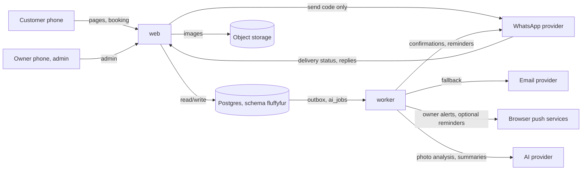

# Fluffy Fur: Salon Website and Booking, Version 1

*   **Author:** @Khalil
*   **Status:** Proposed
*   **Date:** 2026-10-26

--------------------------------------------------------------------------------

## Overview

Fluffy Fur is the website of one dog and cat grooming salon in Israel. It is
in Hebrew, laid out right to left, and runs on the salon's own domain. It
replaces the salon's booking page on Dibs, a third-party booking service, on
a single switch day.

The site has three jobs:

1.  **Show the salon.** It presents the brand, services, prices, hours,
    gallery and products, and is built for search engines. Most visitors
    arrive from the salon's Instagram link.
2.  **Take bookings.** A customer books one or more pets for one visit,
    confirms with a code sent over WhatsApp, and later views, cancels or
    moves the booking through a private link. No customer account or
    password is needed.
3.  **Let the owner run the day.** A small admin area holds the calendar,
    hours, blocked time, services, products, gallery, salon details and
    customer records. It sends the owner an alert for each new, moved or
    cancelled booking.

Two optional AI features help the owner prepare for a visit. Photo analysis
suggests a pet's details from a photo the customer uploads. A pre-visit
summary gives the owner a short note about each booking. Both can be
switched off, have a monthly spending cap, and never block a booking.

Products are display-only. Each has an "Order on WhatsApp" button that opens
a chat with the salon. The site has no cart and no online payment; customers
pay at the salon.

## The Problem

The salon takes bookings through a page on Dibs. The client wants to leave
Dibs for three reasons:

*   **Brand and search presence.** A Dibs page carries Dibs' branding and
    sits on Dibs' domain. The salon wants its own site, which it can grow
    with campaign landing pages and which search engines rank as the salon's
    own.
*   **Phone calls.** Customers call to ask things the current page does not
    answer: whether their dog counts as small or large, whether they can
    bring two pets, and how to move an appointment. Each call interrupts
    grooming.
*   **Cost.** The salon pays Dibs, and wants to pay less to run its own site.

What makes this harder than it looks:

*   **Services depend on the animal.** The price list is split by species,
    weight (dog under or over 10 kg) and age (puppy under 6 months).
    Customers often do not know which service to pick.
*   **Visits can include several pets.** With one groomer, pets are handled
    one after another, so the visit's length is the sum of each pet's
    service. Online booking takes one pet for now (owner decision,
    2026-10-30); see "Choosing the service".
*   **WhatsApp is how the salon talks to customers.** Automated messages
    must go through Meta's paid business service, which needs approved
    message templates. Each message costs money.
*   **The switch is one day.** Dibs is turned off once its customers and
    future appointments have been imported. Nothing may be lost or booked
    twice.

**Proposed solution:** a single web application holding both the public site
and the admin, with a separate worker that sends messages. It is built
around a booking engine that works out free times from opening hours,
blocked time, existing bookings and the total length of the visit. The
database rejects any overlapping bookings. Messages go out through one
routing rule that picks WhatsApp, email or a browser notification for each
message type.

## Goals

Each goal is pass or fail at launch, unless marked as measured after launch.

*   **G1: Complete booking without a phone call.** A customer arriving from
    Instagram on a phone can book one or more pets, choosing a service for
    each, in at most four steps, and receives a WhatsApp confirmation with a
    private link.
*   **G2: No double bookings.** Two confirmed bookings can never overlap.
    The database enforces this. It holds under repeated clicks, two
    customers booking at once, a retried message worker, and owner bookings
    made at the same time as customer bookings.
*   **G3: Self-service changes.** Through the private link, a customer can
    cancel or move a booking up to the owner's cutoff. Past the cutoff, the
    page shows a "Call the salon" button instead.
*   **G4: Messages always arrive by some route.** Verification codes,
    confirmations, reminders and change notices follow one routing table.
    WhatsApp is tried first and email second, with "Call the salon" as the
    last option. Every failed message is listed in the admin.
*   **G5: The owner always knows about bookings.** Every new, moved or
    cancelled booking made online appears in the admin event list and
    raises an owner alert within 60 seconds. If phone alerts stop working,
    the owner is told by email within one day.
*   **G6: The owner runs the salon without the developer.** The owner can
    change hours, blocked time, services, prices, products, gallery and
    salon details, and can create, move and cancel bookings for phone and
    walk-in customers.
*   **G7: Clean switch from Dibs.** Every future Dibs appointment exists in
    the new system before Dibs is turned off. A practice import shows zero
    lost appointments and sends zero alerts and zero messages.
*   **G8: Hebrew, accessible and lawful.** Every page meets the Israeli
    accessibility standard IS 5568 (WCAG 2.0 AA at minimum) and has an
    accessibility statement. The site complies with the Privacy Protection
    Law, Amendment 13: a privacy notice, recorded consent, and customer
    deletion and export.
*   **G9: AI helps but never blocks.** With AI switched off, failing or over
    its monthly cap, booking works exactly as it does with AI on. AI
    spending stops at the cap, about 40 USD a month.
*   **G10: Measured after launch.** The site records booking source
    (Instagram tags), "Book" and "Order on WhatsApp" clicks, and messages
    sent and their cost. After 8 weeks, these figures are compared with the
    baseline recorded before the switch: Dibs monthly cost, calls per week,
    and bookings per week. Numeric targets are set once the baseline exists.

## Non-Goals

*   Cart, checkout, online payment, or any online selling.
*   Booking by chatting in WhatsApp, or a WhatsApp chat bot. The only
    exception is one fixed automatic reply on the automated number, which
    never reads the customer's message.
*   AI writing pages or content, choosing a service or price, or making
    health claims about a pet.
*   The owner building pages. Campaign landing pages are fixed pages that
    the developer builds.
*   Customer accounts with passwords.
*   More than one groomer, or more than one branch.
*   Languages other than Hebrew at launch. Text is kept in translation files
    so other languages can be added later.
*   Running Dibs and the new site side by side.
*   Browser notifications to customers, for reminders or for marketing.
    Only the owner gets browser notifications in version 1.
*   Designing the server, its backups or its monitoring. The app follows the
    server's container rules but does not change them.

## Open Questions

*   **Q1: WhatsApp number.** One number for everything, or a separate number
    for automated messages? The default is a separate number. This must be
    decided before message templates are sent to Meta.
*   **Q2: Customer browser reminders.** Resolved: not in version 1. Owner
    alerts are the only browser notifications. `push_subscriptions` can
    already hold a customer, so they can be added later without a database
    change.
*   **Q3: Content admin.** Build the content pages (products, gallery, salon
    details) into the custom admin, or use an off-the-shelf content tool?
*   **Q4: Owner's booking rules.** Still needed from the owner: slot length,
    gaps between pets and visits, minimum notice, how far ahead customers
    can book, maximum pets per visit, the cancellation cutoff, and whether
    bookings confirm instantly or wait for the owner. Defaults are proposed
    in the Technical Plan.
*   **Q5: Service rules.** Still needed from the owner: which service a
    puppy over 10 kg gets, whether cats have weight groups, whether nail
    trim is an extra or a service of its own, and the real Wednesday hours.
*   **Q6: Dibs export.** What Dibs can export, and in what format. This
    decides how the import script works.
*   **Q7: Legal points to verify.** Whether Dibs-era consent covers messages
    from the new number, and whether the salon falls under any
    accessibility exemption.
*   **Q8: Server-side dependencies (needed before stage 5 of the build).**
    The worker carries messages, owner alerts and AI, so the server side
    must confirm four things:
    1.  The worker container is switched on, within its 256 MB limit.
    2.  The worker can reach Postgres and outbound HTTPS. The build brief
        puts it on the private network only.
    3.  `ffctl` deploys and rolls back web and worker together, at the same
        tag.
    4.  The app reaches Postgres directly with its own restricted role
        (option a in the build brief), not through the REST service.

    Until item 3 is confirmed, outbox rows only ever gain fields, never lose
    or rename them. That way a worker one version apart from web can still
    read them.

## Critical User Journeys (CUJs)

### CUJ 1: New customer books two dogs from Instagram

*   **Given**: A customer taps the salon's Instagram link on an Android
    phone. The link carries tracking tags, and the page opens in Instagram's
    built-in browser. The customer has never booked before.
*   **When**: The customer adds two pets, giving for each a name, species,
    age group, weight range and an optional note and photo. They pick a day
    and a free time, then enter a name and phone number and type the code
    received on WhatsApp.
*   **Then**: One booking is saved with two pet lines. Each line holds the
    service, duration and "from" price copied at booking time. The slot
    covers the summed duration. The customer gets a WhatsApp confirmation
    with the private link and a "Chat with the salon" button. The owner gets
    an alert. The booking records its Instagram source.

### CUJ 2: Customer moves a booking

*   **Given**: A customer has a confirmed booking for next Tuesday and the
    WhatsApp confirmation that holds the private link.
*   **When**: They open the link before the cancellation cutoff, choose
    "move", and pick a new free time.
*   **Then**: The booking moves in one step: the new time is taken and the
    old time is freed together. The customer gets a WhatsApp notice and the
    owner gets an alert. After the cutoff, the page offers only "Call the
    salon".

### CUJ 3: Customer without WhatsApp

*   **Given**: A customer's phone number has no WhatsApp.
*   **When**: The WhatsApp code fails to deliver, or the customer taps
    "Didn't get a code? Send by email" after a short wait.
*   **Then**: The code arrives by email. Confirmation and reminders also go
    by email. Every fallback screen shows a "Call the salon" button.

### CUJ 4: Owner takes a phone booking and blocks a sick day

*   **Given**: The owner is logged in to the admin on their phone.
*   **When**: A caller asks for Thursday at 10:00. Later, the owner blocks
    next Monday as a sick day.
*   **Then**: The phone booking is saved without a code, under the same
    no-overlap rule as online bookings. Blocking Monday warns that three
    bookings fall on it and offers to cancel them. If the owner accepts, the
    three customers get a cancellation message with a link to book again.

### CUJ 5: Owner prepares for a visit with AI on

*   **Given**: The AI features are switched on and under the monthly cap. A
    customer uploads a photo of a poodle mix while booking.
*   **When**: The booking is saved.
*   **Then**: In the background, photo analysis suggests breed, coat type
    and coat condition (for example "matted"). The customer sees the
    suggestions on the confirmation page and can correct them. The admin
    shows a pre-visit summary for the booking. If the AI fails, nothing
    changes for the customer, and the summary shows the plain booking
    details.

### CUJ 6: Switch day

*   **Given**: Practice imports have passed. Dibs is frozen at a fixed time.
*   **When**: The final Dibs export is imported.
*   **Then**: Every future appointment exists as a confirmed booking. No
    alerts or messages fire during the import. Then each imported customer
    gets one message from the new number with their private link. All
    links that pointed to Dibs, including the Instagram bio and the Google
    Business Profile, now point to the new site.

--------------------------------------------------------------------------------

## Technical Plan (Architecture)

### Shape of the system

The system is one repository that produces one image with two entry points:

*   **web**: a Next.js (App Router) server in standalone mode. It serves the
    public pages, the booking flow, the private-link pages, the admin under
    `/admin`, the API routes, and the provider callbacks under
    `/api/webhooks/`. It keeps no state of its own; everything lives in
    Postgres or object storage.
*   **worker**: a Node process from the same code. It sends everything in
    the message outbox, schedules reminders, releases expired slot holds,
    runs AI jobs, checks that owner alerts still arrive, and deletes old
    codes and photos.

Both use the same database code, the same rules and the same provider
adapters. The web container never calls a message or AI provider while a
customer waits, except to send a verification code. Every other outside call
goes through the worker.



Each outside service sits behind a small interface with a fake version for
tests and local work. The services are WhatsApp, email, browser push, AI and
object storage. Which real provider to use is picked in settings, and adding
a provider means adding an adapter, not changing the booking code.

### Data model

All tables live in the `fluffyfur` schema. Times are stored as UTC
(`timestamptz`); opening hours are stored as local Israel times and turned
into UTC per date. Money is stored in agorot as integers.

| Table | Holds | Key rules |
| :---- | :---- | :-------- |
| `settings` | Key-value settings: booking rules, feature switches, the two WhatsApp numbers, AI cap | Edited in admin; every value has a default |
| `business_profile` | One row: name, tagline, city, address, phone, social links, logo, cover | |
| `gallery_images` | Storage key, Hebrew alt text, caption, sort order, consent flag (no longer read: every uploaded photo shows, by the owner's decision of 2026-11-07) | Files in object storage |
| `products` | Hebrew name, description, price, image, active flag, sort order | Display only |
| `services` | Hebrew name, description, duration, "from" price, bookable-online flag, active flag, sort order | Sedation shave is not bookable online |
| `service_rules` | Species, age group, weight group, the resulting service | Owner-editable; see "Choosing the service" |
| `opening_hours` | Weekday, open time, close time, closed flag | Local time |
| `time_off` | Start, end, reason | Blocks booking |
| `customers` | Display name, primary phone (E.164), notes, no-show count, source of record (online, owner, import), Dibs reference | Unique on phone |
| `customer_contacts` | Customer, kind (phone or email), value, verified time | A verified phone or email proves identity |
| `pets` | Customer, name, species, breed, age group, weight group, coat notes, temperament note, vet name, vaccines confirmed at | Kept for the next visit; a pet booked again (same name and species) is updated |
| `appointments` | Customer, start, end, time range, status, hold expiry, created by (customer, owner, import), source tags, notes | No overlap; see below |
| `appointment_pets` | Appointment, pet, position, service, duration and "from" price copied at booking | History survives price edits |
| `manage_tokens` | Appointment, token hash, expiry, revoked time | One booking per token |
| `trusted_devices` | Customer, device token hash, expiry | Lets a returning customer skip the code |
| `verification_codes` | Contact, channel, code hash, expiry, attempts | Deleted after one day |
| `rate_limits` | Key (phone, address, action), window, count | Kept in Postgres because the container keeps no state |
| `consents` | Customer, purpose, channel, granted time, revoked time, source | Purposes: appointment messages, photo use |
| `message_templates` | Key, channel, Hebrew text, provider template name, category | Text lives in data, not code |
| `message_outbox` | Kind, appointment, customer, channel, template, data, send time, status, attempts, provider reference, cost, error | Unique per appointment, kind and channel |
| `inbound_messages` | Number, sender, text, received time, linked customer | Replies to the automated number |
| `push_subscriptions` | Owner (staff) or customer, endpoint, keys, device label, last receipt time | |
| `owner_events` | Type, appointment, data, created time, read time | The owner's record; alerts point here |
| `staff` | Email, password hash, second-factor secret, role | |
| `staff_sessions` | Staff, session hash, expiry, device | |
| `ai_jobs` | Kind (photo, summary), appointment, pet, status, attempts, model, prompt version, cost, result | |
| `ai_spend` | Month, total cost | Checked before each call |
| `audit_log` | Who, what, when, before and after | Appointments, services, hours, settings, staff |
| `site_counters` | Day, key, count | Daily click counts for "Book" and "Order on WhatsApp" |

The existing `fluffyfur.orders` table is left alone until its owner is known.

### No double bookings

`appointments` has a generated `during` time range and an exclusion rule
that rejects two rows whose ranges overlap while both are `held` or
`confirmed`. It uses the `btree_gist` extension and a constant groomer value,
so that more groomers can be added later.

Booking states:

```text
held ──code verified──▶ confirmed ──visit done──▶ completed
  │                         │  └──────────────────▶ no_show
  └─hold expired─▶ released └──cancel──▶ cancelled
```

*   **held**: created when the customer asks for a code. The slot is taken
    for 10 minutes, so nobody else can book it during code entry.
*   Each booking attempt first releases expired holds inside the same
    transaction. The worker also releases them every minute.
*   **Move** is one transaction: the booking's time changes in place, so the
    old slot is freed and the new one taken together, or neither happens.
*   Owner bookings and imported bookings go straight to `confirmed` under
    the same rule.
*   Every form submission carries a one-time key. Sending the same form
    twice returns the first result instead of creating a second booking.

### Choosing the service

The customer chooses a service for each pet (owner decision, 2026-10-29,
from the v0.1.0 client feedback; it replaces the earlier questions about
species, age and weight). A service link on the site arrives with that
service already chosen and shown as chosen.

One pet per online booking for now (owner decision, 2026-10-30): choosing
a service goes straight to the time step, and there is no "bringing
another pet?" choice. Booking code, the database and the owner's phone
bookings still handle several pets; `MULTI_PET_BOOKING` in
`src/server/booking/draft.ts` turns the choice back on.

`service_rules` still map species, age and weight to a service. They now
say which species a service is for (the details step asks dog or cat only
for a service that is for both, such as "nails only"), what age and weight
to save on the pet, which services a dog or cat landing page lists, and the
service for the home page's first free time (a small adult dog). Age is
checked before weight. Defaults until the owner answers (Q5):

| Species | Age | Weight | Service |
| :------ | :-- | :----- | :------ |
| Dog | Under 6 months | Any | Puppy care |
| Dog | 6 months or older | Up to 10 kg | Dog under 10 kg |
| Dog | 6 months or older | Over 10 kg or not sure | Dog over 10 kg (longer slot, safer) |
| Cat | Any | Any | Cat |

Nail trim is offered as a service of its own ("nails only"). It is never
added to a dog or cat groom, which already includes nails. The sedation
shave shows "call to book".

### Working out free times

For a chosen day and list of pets:

1.  Total length = the sum of each pet's service duration, plus the gap
    between pets for each pet after the first, plus the buffer after the
    visit.
2.  Turn that day's opening hours into UTC, using Asia/Jerusalem rules for
    that date. This keeps 09:00 local at 09:00 on both sides of a clock
    change.
3.  Candidate start times run every slot step from opening, up to the last
    start that still ends by closing time.
4.  Remove candidates that overlap time off, overlap held or confirmed
    bookings (plus buffer), fall inside the minimum notice, or fall past the
    booking horizon.
5.  Day status for the weekly strip: closed (no hours or all time off),
    full (open but no candidate fits), or available.

"First available" scans forward day by day up to the horizon. The same code
serves the customer flow, the owner's booking form and the move flow.

Default booking rules until the owner answers (Q4), all held in `settings`:

| Rule | Default |
| :--- | :------ |
| Slot step | 15 minutes |
| Gap between pets | 0 minutes |
| Buffer after a visit | 10 minutes |
| Minimum notice | 2 hours |
| Booking horizon | 30 days |
| Most pets per visit | 3 |
| Cancel or move cutoff | 12 hours before the visit |
| Confirmation | Instant, no owner approval |
| Hold during code entry | 10 minutes |

### Booking flow

The flow has four steps, all usable with a keyboard only. Pages render on
the server, so content can be read without JavaScript.

1.  **Service.** Choose the service; the press goes on to the time step,
    which shows the chosen service with a "change" link. (With
    multi-pet booking on: a service for each pet, listed with their length
    and "from" price, removable, up to the most pets per booking.)
2.  **Time.** Weekly day strip with a status for each day, the free times
    for the chosen day, and a "first available" shortcut. The home page's
    first free time is a link: it saves that start in the draft, the
    service step says so, and the time step offers it first when it fits
    the chosen services (otherwise it says so and shows the free times).
3.  **Details and code.** For each pet: name, breed (optional), the vet or
    clinic (required), and a yes/no box "the pet has a vaccination
    certificate" (optional; booking does not depend on it, and no file is
    stored). Then name and
    phone (required) and email (optional, used only as the fallback).
    What was typed is kept if the form comes back with an error. Optional
    photo per pet after booking, from the private link. Asking for the code
    creates the hold.
    The code goes by WhatsApp. After 30 seconds the page offers "Send by
    email instead" and a "Call the salon" button. A trusted device skips
    the code and confirms directly.
4.  **Confirmation.** The booking is confirmed and the customer sees its
    details. If a photo was sent, the page says it is being checked. The
    outbox gets the confirmation, the reminder and the owner event, all in
    the same transaction as the confirmation.

Instagram tags (`utm_*`, `fbclid`) are read on the first visit, kept in a
cookie, and stored on the booking.

### Identity and private links

*   The phone number is the customer's key and is always collected. Email
    is a second contact. Verifying either one proves identity.
*   One email per phone (owner decision, 2026-10-28). A typed email
    replaces one nobody verified. When the phone already has a verified
    email and another is typed, the code goes to the email on file (masked,
    "k***@proton.me"), with "send the code to my phone" for a customer who
    cannot open it; after the code the new email replaces the old unless the
    customer unticks that. A trusted device replaces it at once. Screens
    name where the code and the confirmation went, masked.
*   A verified customer gets a trusted-device cookie for 90 days, signed and
    stored as a hash, so returning customers are not sent a paid code every
    visit.
*   A private link holds a random token; only its hash is stored. Each token
    covers one booking, expires at the appointment's end time, and is
    revoked when the booking is cancelled. Moving the booking keeps the
    same link.
*   The admin can merge two customer records. Merging moves pets, bookings,
    contacts, consents and push subscriptions to the surviving record.

### Messages

One routing module decides the channel for each message. Booking, admin and
AI only add outbox rows or owner events; they never call a channel directly.
The routing table is the one in `concepts_brief.md`, section 8:

*   **Codes**: WhatsApp first, then email when asked for or when WhatsApp
    reports failure, then "Call the salon".
*   **Confirmations, reminders and change notices**: always WhatsApp; email
    when WhatsApp fails and an email is known; otherwise the message goes to
    the owner's failed-messages list.
*   **Owner alerts**: browser push to every registered owner device. The
    `owner_events` row (the owner's record) and its outbox row (the push)
    are written in the same transaction.

Every message, owner alerts included, travels as an outbox row, and only
`route()` picks its channel. The WhatsApp webhook only records delivery
status; when a status is `failed`, the worker calls `route()` for the next
channel. Codes are the one message sent while the customer waits, but they
still call `route()` and write an outbox row, so their cost and outcome are
recorded the same way.

Sending details:

*   The worker takes outbox rows with row locks that skip rows already
    taken, so two workers never send the same row. A unique key per
    appointment, kind and channel stops the same message being queued
    twice. Retries back off up to five attempts, then mark the row failed.
*   One reminder goes 24 hours before the visit. It is skipped if the
    booking was cancelled or moved, and a moved booking gets a new one.
*   WhatsApp status callbacks (sent, delivered, read, failed) update the
    outbox row. Their signature is checked, and repeated callbacks change
    nothing.
*   Replies to the automated number are stored in `inbound_messages` and
    raise an owner event. They get one fixed reply, at most once per day per
    sender, pointing to the private link and the main number. Opt-out words
    are recorded in `consents`.
*   There are two settings: the automated sender number and the chat number
    used in "Order on WhatsApp" and contact links. With one number, both
    hold the same value (Q1).
*   An admin switch sends every code and message by email when WhatsApp is
    down or restricted, and shows a notice on the booking page.
*   A monthly message cap stops codes once it is reached, showing "Call the
    salon" instead. The owner is told at 80% and at 100%.

### Owner alerts

*   The admin installs to the home screen with its own manifest and service
    worker scope (`/admin/`), separate from the public site.
*   Each push carries only the event type and time, for example "New
    booking, Tue 10:00". Tapping it opens the event in the admin.
*   The admin's service worker posts a receipt back when a push arrives.
    The admin shows the last receipt time per device and has a "send a
    test" button.
*   Every morning the worker sends a check push. If no owner device returns
    a receipt within 6 hours, the owner gets an email saying alerts have
    stopped.
*   Import and owner-made bookings create events marked as already read,
    and they send no push.

### AI features

Each feature has its own switch (`ai.photo`, `ai.summary`), and both are off
until set on in the admin.

*   **When it runs.** After the booking is confirmed, the worker picks up the
    `ai_jobs` row. Booking never waits for it.
*   **Spending cap.** Before each call, the worker adds the expected cost to
    `ai_spend` for the month. If the total would pass the cap, the job is
    skipped and the feature pauses until next month. The owner is alerted.
*   **Photo analysis.** The worker sends the resized photo and gets back a
    fixed set of fields: species, likely breed, coat type, and a coat
    condition from a fixed list (normal, tangled, matted, very matted, or
    unclear). It never comments on skin, injuries or health. Results are
    stored as suggestions. The private-link page shows them for the customer
    to accept or correct, with the line "the final price is set at the
    salon". Accepted values are saved on the pet.
*   **Pre-visit summary.** A short Hebrew note per booking, built from the
    pets, notes, accepted photo results and visit history. It is shown in
    the admin only, the evening before the visit. With AI off, the same
    place shows the plain booking details.
*   **Records.** Every call records its model, prompt version, cost and
    outcome. A timeout of 20 seconds and two attempts apply, and failures
    are silent to the customer.
*   **Photos.** They are re-encoded on the server to remove location data.
    They are kept for 90 days after the visit, then deleted. Uploading one
    records a consent for analysis.
*   **Provider.** The provider sits behind an interface. The proposal is a
    small, low-cost vision model. The choice is confirmed before the first
    paid call.

### Admin

*   Staff log in with email and password (hashed with Argon2id), plus a
    time-based second factor. Sessions use secure, same-site cookies, and
    the login also works inside the home-screen app.
*   **Scheduling**: day and week calendar (FullCalendar, Hebrew,
    right-to-left); create, move, cancel and lengthen bookings; hours; time
    off, with a warning and an offer to cancel affected bookings; mark a
    booking completed or no-show.
*   **Content**: services, service rules, products, gallery, salon details,
    message templates. This is custom until Q3 decides otherwise.
*   **Customers**: search, records, pets, history, notes, merge, export and
    delete.
*   **Inbox**: owner events, failed messages, and replies to the automated
    number, each with read marks.
*   **Settings**: booking rules, feature switches, numbers, caps.

### Public site and search

*   Pages: home, services and prices, hours, products, gallery, contact,
    accessibility statement, privacy notice, the booking flow, and campaign
    landing pages under `/l/<slug>`, which are written as code.
*   Every page sets `lang="he"` and `dir="rtl"` and uses logical CSS
    properties. Numbers, prices, times and Latin product names are wrapped
    so they display in the right order.
*   LocalBusiness structured data, a sitemap and page titles are built from
    `business_profile`. A `noindex` setting stays on until launch.

### Dibs import

A command-line script in the worker package:

1.  Reads the Dibs export into staging tables. The format depends on Q6.
2.  Validates and normalises it: phone numbers to E.164, duplicate
    customers merged by phone, old service names mapped to new services
    through a mapping table.
3.  Imports it with `created_by = import`. This sends no alerts and no
    messages, and records each Dibs reference so the import can be run again
    without duplicates.
4.  Writes a reconciliation report: future appointments in Dibs versus in
    the new system, plus clashes, unmapped services and bad phone numbers.
5.  After the switch, queues one "your new link" message per imported
    future booking. These go out in batches.

A `--dry-run` mode does steps 1, 2 and 4 only, for the practice imports.

### Security and abuse control

*   Zod checks every form, API body and callback.
*   CSRF protection: same-site cookies plus a token on forms.
*   A strict content security policy.
*   No personal data in logs. Logs are JSON lines on standard output.
*   Rate limits on code requests and booking attempts per phone, per
    address and per day, stored in `rate_limits`.
*   A hidden field and a minimum fill time on forms, against bots.
*   The site never reveals whether a phone number already has a booking.
*   Secrets come from environment variables only.

## Alternatives Considered

### Alternative A: Keep Dibs and add a branded marketing site

*   **Pros**: Fastest and cheapest. Dibs keeps handling bookings, reminders
    and payment, and there is no migration and no message cost.
*   **Cons**: Booking still runs on Dibs' page and branding. Customers still
    pick services by name, so the "small or large dog" calls stay. Dibs
    fees stay.
*   **Reason for Rejection**: The client asked for the booking features on
    the salon's own site. This option meets the brand goal only partly, and
    meets neither the phone-call goal nor the cost goal.

### Alternative B: Self-host Cal.com as the booking engine

*   **Pros**: Free under its AGPL licence, and on the same stack
    (TypeScript, Next.js, Postgres). It comes with calendars, reminders and
    an admin.
*   **Cons**:
    *   It books one event type at a time, so several pets per visit with
        added-up durations is not supported.
    *   It is a large app, likely over the 512 MB container limit.
    *   Some features sit in a paid enterprise part.
    *   Changing it and running it publicly means publishing the changes
        under the AGPL.
    *   Its WhatsApp reminders go through Twilio.
    *   Hebrew right-to-left booking steps would mean working against its
        interface.
*   **Reason for Rejection**: The parts it saves (slot calculation and a
    calendar) are small. The parts specific to Fluffy Fur (several pets,
    choosing the service by animal, WhatsApp, Hebrew) would still be custom
    work on top of a heavier base.

### Alternative C: PHP booking tools (Easy!Appointments, LibreBooking)

*   **Pros**: Free and mature.
*   **Cons**: They use PHP and MySQL, outside the planned stack. Each
    booking holds one service, and LibreBooking is built for booking rooms
    and equipment.
*   **Reason for Rejection**: Wrong stack, and no support for several pets
    per visit.

### Alternative D: Google Calendar appointment schedules

*   **Pros**: Free, nothing to host, and it syncs with the owner's phone
    calendar.
*   **Cons**: It runs on Google, not the salon's server. It has one fixed
    length per appointment type, little branding, no Hebrew booking flow the
    salon controls, and no WhatsApp.
*   **Reason for Rejection**: It meets none of the brand, several-pets or
    WhatsApp needs.

### Alternative E: Booking through WhatsApp chat (owner by hand, or a bot)

*   **Pros**: Uses the channel the client prefers, with no booking form to
    build.
*   **Cons**: Calls turn into chats the owner still has to answer. A booking
    made in chat and not typed into the admin is invisible to the website,
    so the same slot can be sold twice. A bot is a large feature of its own.
*   **Reason for Rejection**: It works against the phone-call goal and the
    no-double-booking goal. The client agreed that booking lives only on the
    website.

### Alternative F: Launch the marketing site first, booking later

*   **Pros**: Search ranking starts building months earlier. A delay in Meta
    approval or the Dibs import does not hold back the public site.
*   **Cons**: Two launches, and for a while the "Book" button opens Dibs.
*   **Reason for Rejection**: The client chose a single launch. The cost
    accepted with that choice: search ranking starts only at launch, and any
    late part delays the whole launch.

### Alternative G: Ask for a code only when the private link is opened

*   **Pros**: Fewer paid messages, and a shorter booking flow.
*   **Cons**: Anyone can book under any phone number, which invites fake
    bookings and abuse of the slot calendar.
*   **Reason for Rejection**: The client chose a code at booking. Trusted
    devices bring the cost down for returning customers.

### Alternative H: SMS as the fallback instead of email

*   **Pros**: Reaches any phone, needs no email address, and a code arrives
    within seconds.
*   **Cons**: Each SMS is paid. It adds another provider and sender
    registration, and number-pumping attacks run up SMS costs too.
*   **Reason for Rejection**: The client chose email, which is cheaper. Most
    Israeli customers use WhatsApp, and "Call the salon" covers the rest.

### Alternative I: One WhatsApp number for both chats and automated messages

*   **Pros**: Customers see one number, and replies reach the owner
    directly.
*   **Cons**: It depends on Meta's one-number mode working in Israel and on
    the owner using the WhatsApp Business app (to verify). Without that
    mode, moving the number to the business service cuts the owner off from
    it in the app.
*   **Reason for Rejection**: Not rejected. This is open question Q1. The
    default is two numbers because it does not depend on the unverified
    mode. The design keeps two settings, so one number remains possible.

### Alternative J: Customer browser reminders replace WhatsApp reminders

*   **Pros**: Free per message.
*   **Cons**: There is no delivery receipt, so a lost reminder goes
    unnoticed. Instagram's built-in browser cannot subscribe, and iPhone
    needs a home-screen install. Few customers would be reached.
*   **Reason for Rejection**: Unreliable, and the saving is small. They stay
    out of version 1 entirely (Q2). The subscription table can hold
    customers, so they can be added later.

### Alternative K: n8n for reminders and message sending

*   **Pros**: Already on the server, with visual workflows and built-in
    integrations.
*   **Cons**: Booking logic would be split between the app and n8n. The
    outbox rules (send once, retry, fall back) and their tests would live
    outside the repository. It is also a shared service the app does not
    control.
*   **Reason for Rejection**: An own worker keeps all message rules in one
    place, versioned and tested with the booking code.

### Alternative L: Off-the-shelf content tool for products, gallery and salon details

*   **Pros**: Ready-made editing screens, image handling and drafts.
*   **Cons**: Another service to host and secure, a second login for the
    owner, and content split between two systems.
*   **Reason for Rejection**: Not rejected yet. This is open question Q3.
    The content screens are few and simple, so the default is the custom
    admin.

### Alternative M: Cart and online checkout for products

*   **Pros**: Direct online sales.
*   **Cons**: Delivery or pickup, stock, legally required tax invoices, and
    Israel's distance-sale cancellation and returns rules. It is a project
    of its own.
*   **Reason for Rejection**: The client chose "Order on WhatsApp" with no
    online selling.

### Alternative N: AI writing landing pages and content

*   **Pros**: The owner could make campaign pages without the developer.
*   **Cons**: It needs a page builder. Search engines penalise thin
    mass-produced pages. Generated pages could break the right-to-left
    layout, accessibility, or the brand, and generated Hebrew needs checking.
*   **Reason for Rejection**: Dropped by the client. The developer builds
    landing pages as fixed pages.

--------------------------------------------------------------------------------

## Non-Functional Requirements

*   **Security & Privacy**:
    *   Personal data is limited to names, phone numbers, optional emails,
        pet details, photos, and push endpoints.
    *   A Hebrew privacy notice names each recipient abroad: Meta, the email
        provider, the AI provider, and the push services.
    *   Consents are recorded per purpose.
    *   The owner can export and delete a customer.
    *   Codes are deleted after one day, and photos 90 days after the visit.
    *   No personal data appears in logs or on lock screens.
    *   Staff logins use a second factor.
*   **Performance**:
    *   The web container stays under 512 MB at normal load.
    *   Pages render on the server for slow mobile connections.
    *   Images are resized and compressed, and the gallery loads lazily.
    *   Working out free times for a day is one query over that day's
        bookings and time off.
*   **Cost model (checked before launch)**:
    *   Monthly cost = bookings × (code + confirmation + reminder messages,
        priced by Meta category) + moves and cancels × change notices +
        second number + email service + AI cap + hosting share.
    *   Before launch, fill this in with Meta's current Israeli prices and
        the baseline booking count. The launch check: the estimated monthly
        cost is below the Dibs monthly bill. If it is not, the levers are
        already in the design: trusted-device lifetime (fewer codes), one
        number instead of two, and a lower AI cap.
    *   G10 then confirms the estimate with measured figures.
*   **Cost recording**:
    *   Every paid call (message, email, AI) is recorded with its cost.
    *   Paid messages and AI each have a monthly cap that fails safe: codes
        fall back to "Call the salon", and AI pauses.
*   **Rollout & Rollback**:
    *   Database changes are plain SQL migrations that only add things
        first, so the previous version keeps working after a rollback.
    *   Feature switches (AI and the WhatsApp outage mode) can
        be turned off without a release.
    *   **Switch-day way back.** There is a go/no-go window: from the final
        import until 24 hours later, or until the first booking made on the
        new site, whichever comes first. Inside the window, rolling back
        means unfreezing Dibs. No new-site bookings exist yet, so nothing is
        lost. After the window, problems are fixed forward on the new site.
        If the new site must still be abandoned, the import script exports
        all future bookings as a CSV for entering into Dibs by hand, and
        affected customers get a notice.

--------------------------------------------------------------------------------

## Detailed Implementation Plan

### Ground rules for the build

*   **Runtime and tools**:
    *   Node.js 22 LTS, pnpm, TypeScript in strict mode.
    *   Next.js App Router, built with `output: "standalone"`.
    *   Tailwind CSS with logical properties only.
*   **Libraries** (pinned versions, all free):
    *   `zod`, `pg`, `@date-fns/tz` with `date-fns`;
    *   `argon2`, `otplib`, `web-push`, `sharp`;
    *   `@aws-sdk/client-s3` (works with Supabase Storage's S3 interface);
    *   `@fullcalendar/react` with `core`, `timegrid`, `daygrid`,
        `interaction` and the `he` locale;
    *   `pino` for logs;
    *   `vitest`, `@playwright/test`, `eslint`, `prettier`.
*   **No translation library.** Hebrew strings live in `src/i18n/he.json`
    and are read through a small `t()` helper, so a second language later
    means adding a second JSON file.
*   **Provider choice.** Each outside service has an interface, a fake for
    tests and local work, and one real adapter, all chosen in settings:
    *   WhatsApp: direct to Meta's Cloud API.
    *   Email: a generic HTTPS adapter, configured by environment variables.
    *   AI: Anthropic's API (proposal; the model is confirmed before the
        first paid call).
    *   Storage: S3-compatible.
*   **No code runs migrations on start-up.** Migrations are a separate
    command, run as a release step.

Repository layout:

```text
src/app/            Next.js routes: public site, booking, private link, admin, API
src/server/         Domain code shared by web and worker (no React)
src/components/     React components
src/i18n/           Hebrew strings
worker/             Worker entry point and jobs
db/migrations/      Plain SQL, applied in order
db/seed/            Seed script and data
scripts/            Command-line tools (migrate, import, create staff)
docker/             Production image and local compose file
tests/unit/         Vitest
tests/e2e/          Playwright, Hebrew, right-to-left
.github/workflows/  CI
```

### Build order

All parts go live together on switch day; this is the order they are built
in. Each stage ends with its tests passing and a short note of what was
built and what was skipped.

| Stage | Files (by number below) |
| :---- | :---------------------- |
| 1. Foundation | 1–17, 83–85, 90 |
| 2. Data and engine | 18–36 |
| 3. Public site | 37–47, 89 |
| 4. Booking and identity | 48–58, 86 |
| 5. Messages and owner alerts | 59–68 |
| 6. Admin | 69–78, 88 |
| 7. AI | 79–82, 87 |
| 8. Import and launch | 91–95 |

### Target Files to Create/Modify

#### Foundation

#### 1. `package.json` (Create)

*   **Type / Scope**: Build configuration.
*   **Proposed Changes**: Pins the libraries above. Scripts: `dev`, `build`,
    `start` (web), `worker`, `migrate`, `seed`, `import:dibs`,
    `staff:create`, `lint`, `typecheck`, `test`, `test:e2e`. The
    `packageManager` field pins pnpm.

#### 2. `pnpm-lock.yaml` (Create)

*   **Type / Scope**: Lock file.
*   **Proposed Changes**: Generated, and committed so builds are
    reproducible and dependencies can be scanned.

#### 3. `tsconfig.json` (Create)

*   **Type / Scope**: Build configuration.
*   **Proposed Changes**: Strict mode, `noUncheckedIndexedAccess`, and a path
    alias `@/` pointing to `src/`.

#### 4. `next.config.ts` (Create)

*   **Type / Scope**: Build configuration.
*   **Proposed Changes**: `output: "standalone"`. Security headers: the
    content security policy, `X-Content-Type-Options`, `Referrer-Policy`, and
    `X-Robots-Tag: noindex` while the `site.noindex` setting is on. Image
    domains point to the storage endpoint.

#### 5. `tailwind.config.ts` and `src/app/globals.css` (Create)

*   **Type / Scope**: Styling.
*   **Proposed Changes**: The brand colours, as tokens that pass AA
    contrast. A Hebrew font with full coverage (Heebo or Assistant, served
    by the app). Base styles that use logical properties only. A visible
    focus ring on every interactive element.

#### 6. `eslint.config.mjs` and `.prettierrc` (Create)

*   **Type / Scope**: Static analysis.
*   **Proposed Changes**: TypeScript-strict rules, `jsx-a11y`, and a custom
    rule that bans the physical CSS classes `ml-`, `mr-`, `pl-`, `pr-`,
    `left-` and `right-`.

#### 7. `env.example` (Create)

*   **Type / Scope**: Configuration documentation.
*   **Proposed Changes**: Every environment variable, each with a one-line
    explanation:
    *   `APP_BASE_URL`, `DATABASE_URL`, `SESSION_SECRET`;
    *   `WHATSAPP_API_TOKEN`, `WHATSAPP_PHONE_NUMBER_ID`,
        `WHATSAPP_BUSINESS_ACCOUNT_ID`;
    *   `EMAIL_API_URL`, `EMAIL_API_KEY`, `EMAIL_FROM`;
    *   `VAPID_PUBLIC_KEY`, `VAPID_PRIVATE_KEY`, `VAPID_SUBJECT`;
    *   `AI_API_KEY`;
    *   `STORAGE_ENDPOINT`, `STORAGE_BUCKET`, `STORAGE_ACCESS_KEY`,
        `STORAGE_SECRET_KEY`;
    *   `WEBHOOK_SECRET_MESSAGING`;
    *   `PORT`, `HEALTH_PATH`, `LOG_LEVEL`.

    Settings the owner may change (numbers, caps, rules) are not
    environment variables. They live in the `settings` table.

#### 8. `src/server/config.ts` (Create)

*   **Type / Scope**: TypeScript module.
*   **Proposed Changes**: Reads and checks the environment once with Zod and
    exports a typed `config`. A missing required variable stops the process
    at start-up with a clear message.

#### 9. `src/server/log.ts` (Create)

*   **Type / Scope**: TypeScript module.
*   **Proposed Changes**: A `pino` logger writing JSON lines to standard
    output. Redaction paths remove phone, email, name, token and code
    fields.

#### 10. `src/server/db.ts` (Create)

*   **Type / Scope**: TypeScript module.
*   **Proposed Changes**: A `pg` pool with `search_path=fluffyfur`, plus
    `withTransaction(fn)` and a typed `query()`. This is the only module
    that talks to Postgres; the repositories in 18–30 use it.

#### 11. `src/server/time.ts` (Create)

*   **Type / Scope**: TypeScript module.
*   **Proposed Changes**: Fixes the zone to `Asia/Jerusalem`. Functions:
    *   `localDateTimeToUtc(date, "HH:mm")`;
    *   `utcToLocal(instant)`;
    *   `localDayBounds(date)`;
    *   `formatHe(instant, pattern)` (dates as DD/MM, weeks starting on
        Sunday).

    Nothing else in the code builds dates by hand.

#### 12. `src/i18n/he.json` and `src/i18n/t.ts` (Create)

*   **Type / Scope**: Translation.
*   **Proposed Changes**: Every Hebrew interface string, by key. `t(key,
    vars)` fills in values and wraps numbers, times, prices and phone
    numbers in a `<bdi>`-safe form. Message templates are not here; they
    live in the database (21).

#### 13. `src/app/layout.tsx` (Create)

*   **Type / Scope**: Root layout.
*   **Proposed Changes**: `<html lang="he" dir="rtl">`, the font, a skip
    link, and the header and footer with links to the accessibility
    statement and the privacy notice.

#### 14. `src/app/healthz/route.ts` (Create)

*   **Type / Scope**: API route.
*   **Proposed Changes**: `GET` returns 200 with `{status:"ok"}` once the
    database answers `select 1`, and 503 otherwise. The path follows
    `HEALTH_PATH`.

#### 15. `docker/Dockerfile` (Create)

*   **Type / Scope**: Production image.
*   **Proposed Changes**: A multi-stage build: install, build, then a slim
    runtime image. It runs as a non-root user and holds the standalone
    server, the worker bundle and the `scripts/`. The default command
    starts web; the worker uses the same image with `node worker/dist/main.js`.
    No secrets go in the image. It handles SIGTERM.

#### 16. `docker/compose.dev.yml` (Create)

*   **Type / Scope**: Local environment.
*   **Proposed Changes**: Services:
    *   Postgres 16 with `btree_gist`;
    *   MinIO as local S3 storage;
    *   web and worker in development mode.

    All providers are set to their fakes.

#### 17. `.github/workflows/ci.yml` (Create)

*   **Type / Scope**: CI pipeline.
*   **Proposed Changes**:
    *   **On pull request**: install, lint, typecheck, unit tests, a check
        that runs migrations up on a throwaway Postgres, the end-to-end
        booking tests, and a dependency scan with `pnpm audit`.
    *   **On merge to main**: build the image, tag it with the commit SHA,
        and push it to GitHub Container Registry. Deploying stays a manual
        step outside this design.

#### Data and engine

#### 18. `db/migrations/0001_extensions_and_settings.sql` (Create)

*   **Type / Scope**: SQL migration.
*   **Proposed Changes**:
    *   Creates the extensions `btree_gist` and `pgcrypto` if missing.
    *   Creates `schema_migrations`, `settings(key text pk, value jsonb,
        updated_at)` and `audit_log`.
    *   Turns on row-level security for each table, with a policy that
        allows only the app's own role.

#### 19. `db/migrations/0002_content.sql` (Create)

*   **Type / Scope**: SQL migration.
*   **Proposed Changes**: Creates `business_profile`, `gallery_images`,
    `products`, `services` (with `bookable_online`), `service_rules`
    (species, age_group, weight_group, service_id, unique on the first
    three), `opening_hours`, `time_off` and `site_counters(day, key,
    count)`. Prices are integers in agorot.
    Row-level security is on.

#### 20. `db/migrations/0003_customers_and_bookings.sql` (Create)

*   **Type / Scope**: SQL migration.
*   **Proposed Changes**:
    *   **Customer tables**:
        *   `customers`, with `phone_e164` unique;
        *   `customer_contacts`;
        *   `pets`.
    *   **Booking tables**:
        *   `appointments`;
        *   `appointment_pets`;
        *   `manage_tokens`;
        *   `trusted_devices`;
        *   `verification_codes`;
        *   `rate_limits`;
        *   `consents`.
    *   **`appointments` columns**:
        *   `groomer smallint not null default 1`;
        *   `starts_at` and `ends_at` (`timestamptz`);
        *   `during tstzrange generated always as (tstzrange(starts_at,
            ends_at, '[)')) stored`;
        *   `status` (held, confirmed, cancelled, completed, no_show,
            released);
        *   `hold_expires_at`;
        *   `created_by` (customer, owner, import);
        *   `source jsonb`;
        *   `dibs_ref unique`;
        *   `idempotency_key unique`.
    *   **The no-overlap rule**: `exclude using gist (groomer with =, during
        with &&) where (status in ('held','confirmed'))`.
    *   Row-level security is on.

#### 21. `db/migrations/0004_messaging.sql` (Create)

*   **Type / Scope**: SQL migration.
*   **Proposed Changes**:
    *   Creates `message_templates`, `message_outbox` and
        `inbound_messages`.
    *   `message_outbox` is unique on (`appointment_id`, `kind`, `channel`,
        `send_at`).
    *   Also creates `push_subscriptions` (exactly one of `staff_id` or
        `customer_id`) and `owner_events`.
    *   Adds an index on outbox (`status`, `send_at`) for the worker.

#### 22. `db/migrations/0005_staff_and_ai.sql` (Create)

*   **Type / Scope**: SQL migration.
*   **Proposed Changes**: Creates `staff`, `staff_sessions`, `ai_jobs` and
    `ai_spend` (unique month). Row-level security is on.

#### 23. `scripts/migrate.ts` (Create)

*   **Type / Scope**: Command-line tool.
*   **Proposed Changes**: Applies the `db/migrations/*.sql` files not yet in
    `schema_migrations`, in name order, one transaction each. `--check`
    lists pending files without applying them.

#### 24. `db/seed/seed.ts` and `db/seed/data.he.json` (Create)

*   **Type / Scope**: Seed script and data.
*   **Proposed Changes**: Inserts the data from the build brief:
    *   the six services (with the sedation shave set to not bookable
        online);
    *   the eight products;
    *   the opening hours (Wednesday marked closed until the owner
        confirms);
    *   the default service rules from the Technical Plan;
    *   default settings;
    *   the Hebrew message templates;
    *   an empty business profile.

    It skips rows that already exist, so running it again changes nothing.

#### 25. `src/server/repos/settings.ts` (Create)

*   **Type / Scope**: Repository.
*   **Proposed Changes**: `getSettings()` returns a Zod-checked, typed
    object with defaults. `updateSetting(key, value, staffId)` writes the
    audit log. The defaults include:
    *   booking rules: slot step, gap, buffer, notice, horizon, most pets,
        cutoff, hold minutes;
    *   feature switches: `ai.photo`, `ai.summary`,
        `messaging.whatsappOutage`, `site.noindex`;
    *   numbers: `whatsapp.senderNumber`, `whatsapp.chatNumber`;
    *   caps: `cap.messagesMonthly`, `cap.aiMonthlyAgorot`.

#### 26. `src/server/repos/catalog.ts` (Create)

*   **Type / Scope**: Repository.
*   **Proposed Changes**: Reads and writes services, service rules,
    products, gallery, business profile, opening hours and time off. Every
    write goes into the audit log.

#### 27. `src/server/repos/customers.ts` (Create)

*   **Type / Scope**: Repository.
*   **Proposed Changes**: `findOrCreateByPhone`, `addContact`,
    `markVerified`, `listPets`, `upsertPet`, `merge(keepId, dropId)` (moves
    pets, bookings, contacts, consents and subscriptions), `exportAll(id)`
    and `erase(id)`. Erase deletes personal data and keeps anonymised
    bookings for the records.

#### 28. `src/server/repos/appointments.ts` (Create)

*   **Type / Scope**: Repository.
*   **Proposed Changes**:
    *   `createHold`, `confirm`, `move`, `cancel`, `markCompleted`,
        `markNoShow`, `releaseExpiredHolds`, `listForRange` and
        `getByToken`.
    *   Each runs in a transaction. An overlap error from the exclusion
        rule is turned into a `SlotTaken` result, never thrown to the user.

#### 29. `src/server/repos/outbox.ts` (Create)

*   **Type / Scope**: Repository.
*   **Proposed Changes**:
    *   `enqueue(rows)`, which skips duplicates on the unique key.
    *   `claimDue(limit)`, using `for update skip locked`.
    *   `markSent`, `markFailed` and `applyStatusCallback`.
    *   `monthlyCount()`, for the message cap.

#### 30. `src/server/repos/events.ts` (Create)

*   **Type / Scope**: Repository.
*   **Proposed Changes**: `addOwnerEvent(type, appointmentId, data,
    {silent})` writes the event and, in the same transaction, its push
    outbox row. Also `listUnread`, `markRead` and `listFailedMessages`. A
    silent event is stored as already read and queues no push.

#### 31. `src/server/booking/serviceRules.ts` (Create)

*   **Type / Scope**: Domain logic.
*   **Proposed Changes**: `resolveService(pet, rules)` returns the service
    for a pet's species, age group and weight group, checking age before
    weight. It returns `NotBookableOnline` for services marked as such.

#### 32. `src/server/booking/slots.ts` (Create)

*   **Type / Scope**: Domain logic.
*   **Proposed Changes**: These are pure functions with no database access:
    *   `visitLength(pets, rules)`;
    *   `freeSlots(date, length, hours, timeOff, busy, rules, now)`;
    *   `dayStatus(...)`, which returns closed, full or available;
    *   `firstAvailable(...)`.

    The function steps are in the Technical Plan. All arithmetic is in
    UTC, with day bounds from `time.ts`.

#### 33. `src/server/booking/service.ts` (Create)

*   **Type / Scope**: Domain logic.
*   **Proposed Changes**: These functions combine the repositories and the
    pure functions, and every public entry point checks its input with Zod:
    *   `getWeek(date, pets)`;
    *   `requestHold(input)`, which checks rate limits, resolves services,
        re-checks the slot and creates the hold;
    *   `confirmBooking(holdId)`, which in one transaction confirms the
        booking, creates the manage token and queues the confirmation, the
        reminder, the owner event and the AI jobs;
    *   `moveBooking(token, newStart)`;
    *   `cancelBooking(token)`, which checks the cutoff;
    *   `ownerCreateBooking(input, staffId)`.

#### 34. `tests/unit/slots.test.ts` (Create)

*   **Type / Scope**: Unit test.
*   **Proposed Changes**:
    *   Sums durations for one, two and three pets.
    *   Checks buffer and gap handling.
    *   Checks that the last slot ends by closing time.
    *   Checks that time off removes slots.
    *   Checks minimum notice and the horizon.
    *   Day status covers all three values.
    *   Checks clock changes: on 25 October 2026 and 27 March 2026, a 09:00
        opening stays 09:00 local, and no slot is doubled or skipped across
        the change.

#### 35. `tests/unit/serviceRules.test.ts` (Create)

*   **Type / Scope**: Unit test.
*   **Proposed Changes**:
    *   A puppy over 10 kg gets puppy care.
    *   "Not sure" gets the large dog service.
    *   A cat gets the cat service.
    *   The sedation shave is refused online.
    *   A nail trim cannot be added to a groom.

#### 36. `tests/unit/appointments.db.test.ts` (Create)

*   **Type / Scope**: Database test against Postgres.
*   **Proposed Changes**:
    *   Twenty parallel `requestHold` calls for the same slot give exactly
        one hold.
    *   Expired holds are released and the slot becomes free.
    *   A move swaps in one step.
    *   An owner booking that clashes with a held slot is refused.
    *   The same idempotency key returns the same booking.

#### Public site

#### 37. `src/app/(site)/page.tsx` (Create)

*   **Type / Scope**: Page.
*   **Proposed Changes**: The home page: cover, logo, name, tagline, city,
    the contact buttons, a "Book now" button, a services teaser, the hours
    and a gallery strip. The contact buttons are call, WhatsApp (chat
    number), Waze, Instagram, Facebook and TikTok.

#### 38. `src/app/(site)/services/page.tsx` (Create)

*   **Type / Scope**: Page.
*   **Proposed Changes**: The service list, with what each includes, its
    duration and its "from" price, and the line "the final price is set at
    the salon".

#### 39. `src/app/(site)/products/page.tsx` (Create)

*   **Type / Scope**: Page.
*   **Proposed Changes**: The product cards. Each has an "Order on
    WhatsApp" link: `https://wa.me/<chat number without + or 0>?text=` with
    a percent-encoded Hebrew message naming the product and its price.

#### 40. `src/app/(site)/gallery/page.tsx` (Create)

*   **Type / Scope**: Page.
*   **Proposed Changes**: Lazily loaded, resized images with Hebrew alt
    text, keyboard-navigable.

#### 41. `src/app/(site)/hours/page.tsx` and `src/app/(site)/contact/page.tsx` (Create)

*   **Type / Scope**: Pages.
*   **Proposed Changes**: Opening hours with today highlighted, and upcoming
    time off. The contact page shows the address, the phone, both WhatsApp
    numbers with their roles, and a map link.

#### 42. `src/app/(site)/accessibility/page.tsx` and `src/app/(site)/privacy/page.tsx` (Create)

*   **Type / Scope**: Pages.
*   **Proposed Changes**: The Hebrew accessibility statement required by IS
    5568, with a contact for accessibility issues. The privacy notice: what
    is collected, why, the recipients abroad, how long data is kept, and how
    to ask for deletion.

#### 43. `src/app/(site)/l/[slug]/page.tsx` and `src/landing/` (Create)

*   **Type / Scope**: Pages and components.
*   **Proposed Changes**: The campaign landing pages. Each page is a file in
    `src/landing/<slug>.tsx` built from shared sections: hero, service
    highlight, gallery strip, call to book and FAQ. "Book" links can carry a
    pre-chosen species.

#### 44. `src/components/site/` (Create)

*   **Type / Scope**: React components.
*   **Proposed Changes**: Header, footer, contact buttons, service card,
    product card, gallery grid, the landing sections, and `Price`, `Phone`
    and `Time`, which wrap values in `<bdi>`.

#### 45. `src/app/sitemap.ts` and `src/app/robots.ts` (Create)

*   **Type / Scope**: Search.
*   **Proposed Changes**: The sitemap of public pages and landing pages.
    Robots disallows everything while `site.noindex` is on.

#### 46. `src/server/seo.ts` (Create)

*   **Type / Scope**: TypeScript module.
*   **Proposed Changes**: Builds the LocalBusiness JSON-LD (name, address,
    phone, hours, geo, social links) and the page titles and descriptions
    from `business_profile`.

#### 47. `src/server/tracking.ts` and `src/middleware.ts` (Create)

*   **Type / Scope**: TypeScript module and middleware.
*   **Proposed Changes**:
    *   The middleware stores `utm_*` and `fbclid` from the first visit in a
        signed cookie.
    *   `src/server/tracking.ts` stores the data on the booking.
    *   It also counts clicks on "Book" and "Order on WhatsApp" per day in
        `site_counters(day, key, count)`, created in migration 0002.
    *   The middleware also adds the CSRF token cookie.

#### Booking and identity

#### 48. `src/app/(site)/book/page.tsx` (Create)

*   **Type / Scope**: Page.
*   **Proposed Changes**: The four-step flow, built as server-rendered steps
    with forms that work without client JavaScript. JavaScript improves the
    flow by loading days and slots in place. The step is kept in the URL, so
    the back button works.

#### 49. `src/components/booking/` (Create)

*   **Type / Scope**: React components.
*   **Proposed Changes**:
    *   `PetForm`: species, age, weight, name, note and photo, with labelled
        fields and Hebrew error messages.
    *   `DayStrip`: seven days with their status, and arrow-key navigation.
    *   `SlotList` and `FirstAvailable`.
    *   `ContactForm`.
    *   `CodeEntry`: a one-time-code field, the "send by email" option after
        30 seconds, and the call button.
    *   `Summary`.

#### 50. `src/app/api/booking/week/route.ts` (Create)

*   **Type / Scope**: API route.
*   **Proposed Changes**: `GET ?date&pets=` returns the day statuses and the
    free slots, computed by `booking/service.getWeek`.

#### 51. `src/app/api/booking/hold/route.ts` (Create)

*   **Type / Scope**: API route.
*   **Proposed Changes**: `POST` runs the checks, creates the hold and sends
    the code. Its checks are the CSRF token, the idempotency key, the hidden
    field, the minimum fill time and the rate limits. A trusted-device
    cookie confirms directly instead. It returns the hold id and its expiry,
    or `SlotTaken`.

#### 52. `src/app/api/booking/verify/route.ts` (Create)

*   **Type / Scope**: API route.
*   **Proposed Changes**: `POST` checks the code. Allowed: 5 attempts, codes
    valid for 10 minutes, 3 sends per phone per hour, and 10 per address per
    hour. On success it confirms the booking, sets the trusted-device
    cookie, and returns the confirmation page address.

#### 53. `src/app/api/booking/resend/route.ts` (Create)

*   **Type / Scope**: API route.
*   **Proposed Changes**: `POST {channel: "whatsapp" | "email"}` sends the
    code again under the same rate limits. Email needs an email address on
    the hold.

#### 54. `src/server/identity/codes.ts` (Create)

*   **Type / Scope**: Domain logic.
*   **Proposed Changes**:
    *   `issueCode(contact, channel)` creates a 6-digit code and stores it
        as a hash. It asks `route()` for the channel, writes an outbox row,
        and sends that row at once instead of waiting for the worker. Codes
        are the one synchronous send.
    *   `checkCode(contact, code)`.
    *   `cleanup()`.

#### 55. `src/server/identity/tokens.ts` (Create)

*   **Type / Scope**: Domain logic.
*   **Proposed Changes**: Random 32-byte tokens with hashes stored using
    `SESSION_SECRET`:
    *   `issueManageToken(appointmentId, expiresAt)`;
    *   `resolveManageToken(raw)`;
    *   `revoke(appointmentId)`;
    *   `issueTrustedDevice(customerId)`;
    *   `resolveTrustedDevice(raw)`.

#### 56. `src/server/identity/rateLimit.ts` (Create)

*   **Type / Scope**: Domain logic.
*   **Proposed Changes**: `hit(key, window, max)` counts actions in the
    `rate_limits` table and returns allowed or blocked.

#### 57. `src/app/(site)/b/[token]/page.tsx` (Create)

*   **Type / Scope**: Page.
*   **Proposed Changes**: The private-link page:
    *   booking details;
    *   AI photo suggestions to accept or correct, when there are any;
    *   move and cancel, before the cutoff;
    *   "Call the salon" after it;
    *   withdrawing consent to appointment messages.

    An expired or revoked token shows a Hebrew notice and a link to book
    again.

#### 58. `tests/e2e/booking.spec.ts` (Create)

*   **Type / Scope**: E2E test.
*   **Proposed Changes**: The tests run on a phone-size viewport, with the
    Hebrew locale, fake providers and seeded data:
    *   a new customer books two dogs using only the keyboard;
    *   an axe accessibility check runs on every step;
    *   `dir=rtl` is checked;
    *   the confirmation shows up in the fake WhatsApp outbox;
    *   a move and a cancel through the private link;
    *   after the cutoff, only the call button shows;
    *   the email fallback path;
    *   two browsers race for one slot and one of them gets `SlotTaken`.

#### Messages and owner alerts

#### 59. `src/server/notify/types.ts` (Create)

*   **Type / Scope**: Interfaces.
*   **Proposed Changes**:
    *   `MessageKind` = code, confirmation, reminder, customer_change,
        owner_change, import_link, owner_alert, owner_check.
    *   The `Channel` interfaces `WhatsAppChannel`, `EmailChannel` and
        `PushChannel`, each with `send(msg): Promise<SendResult>`.

#### 60. `src/server/notify/routing.ts` (Create)

*   **Type / Scope**: Domain logic.
*   **Proposed Changes**: `route(kind, customer, settings)` returns the
    ordered channel list from the routing table. It applies the outage
    switch and the monthly cap. Nothing else
    decides channels.

#### 61. `src/server/notify/whatsapp.ts` and `src/server/notify/whatsapp.fake.ts` (Create)

*   **Type / Scope**: Provider adapter and fake.
*   **Proposed Changes**: The real adapter sends template messages through
    Meta's Cloud API, with Hebrew text parameters and URL buttons for the
    private link and the "Chat with the salon" link. The fake records sends
    in memory and in a test table for the end-to-end tests.

#### 62. `src/server/notify/email.ts` and `src/server/notify/email.fake.ts` (Create)

*   **Type / Scope**: Provider adapter and fake.
*   **Proposed Changes**: The real adapter posts to the HTTPS email API set
    by `EMAIL_API_URL`. Emails use Hebrew right-to-left HTML templates, with
    a plain-text copy.

#### 63. `src/server/notify/push.ts` and `src/server/notify/push.fake.ts` (Create)

*   **Type / Scope**: Provider adapter and fake.
*   **Proposed Changes**:
    *   Uses `web-push` with VAPID, a `TTL` that ends before the event goes
        stale, and `Urgency: high`.
    *   A 404 or 410 deletes the subscription.
    *   A 429 or 5xx retries.
    *   The payload holds only the event type, the time and a path.

#### 64. `src/app/api/webhooks/whatsapp/route.ts` (Create)

*   **Type / Scope**: API route (not behind the password gate).
*   **Proposed Changes**:
    *   `GET` answers Meta's verification challenge.
    *   `POST` checks the signature, then handles status updates and
        incoming messages.
    *   **Status updates** go to `outbox.applyStatusCallback`, which only
        records them. On `failed`, the worker asks `route()` for the next
        channel.
    *   **Incoming messages** go into `inbound_messages` and create an owner
        event. Opt-out words revoke consent. One fixed reply goes out at
        most once a day per sender.
    *   Repeated callbacks change nothing, and the log holds ids only.

#### 65. `src/app/api/push/receipt/route.ts` and `src/app/api/push/subscribe/route.ts` (Create)

*   **Type / Scope**: API routes.
*   **Proposed Changes**: `subscribe` stores a subscription for the
    logged-in staff member only. `receipt` updates `last_receipt_at`.

#### 66. `worker/main.ts` (Create)

*   **Type / Scope**: Worker entry point.
*   **Proposed Changes**:
    *   A loop every 5 seconds that claims due outbox rows and sends them
        through `routing` and the channels.
    *   Timed jobs:
        *   release expired holds, every minute;
        *   clean up codes, daily;
        *   send the owner check push, daily at 08:00 local;
        *   check owner receipts, at 14:00;
        *   delete photos past retention, daily;
        *   build the pre-visit summaries, at 19:00 for the next day.
    *   It shuts down cleanly on SIGTERM.

#### 67. `worker/jobs/ownerAlerts.ts` (Create)

*   **Type / Scope**: Worker job.
*   **Proposed Changes**:
    *   Queues the daily check push as an outbox row; owner alert pushes
        are already queued with their event (file 30), so this job only
        handles the check.
    *   The daily check push.
    *   If no owner receipt has arrived in 6 hours, it emails the owner.

#### 68. `tests/unit/routing.test.ts` and `tests/unit/outbox.db.test.ts` (Create)

*   **Type / Scope**: Unit and database tests.
*   **Proposed Changes**:
    *   Every row of the routing table, including the outage switch and the
        cap.
    *   Two workers never send the same row.
    *   A failed callback queues email once.
    *   A repeated callback changes nothing.
    *   A cancelled booking's reminder is skipped.

#### Admin

#### 69. `src/app/admin/login/page.tsx` and `src/app/api/admin/auth/route.ts` (Create)

*   **Type / Scope**: Page and API route.
*   **Proposed Changes**:
    *   Email and password login, then the TOTP code.
    *   Lockout after 10 failures in 15 minutes.
    *   Sets a secure, same-site, HTTP-only session cookie for 30 days that
        renews on use, so the home-screen app stays logged in.
    *   Logout.

#### 70. `src/server/staff/auth.ts` and `scripts/staff-create.ts` (Create)

*   **Type / Scope**: Domain logic and command-line tool.
*   **Proposed Changes**: Argon2id hashing, TOTP setup and checking, and
    session create, resolve and revoke. The script creates the first owner
    account and prints a TOTP setup code.

#### 71. `src/app/admin/layout.tsx`, `src/app/admin/manifest.ts` and `public/admin-sw.js` (Create)

*   **Type / Scope**: Layout, web manifest and service worker.
*   **Proposed Changes**:
    *   The admin layout requires a session.
    *   The manifest has scope `/admin/`, its own name and icon, and
        `display: standalone`.
    *   The service worker handles `push` (show the notification with
        `lang: he` and `dir: rtl`, then post a receipt) and
        `notificationclick` (open the event).

#### 72. `src/app/admin/page.tsx` (Create)

*   **Type / Scope**: Page.
*   **Proposed Changes**: Today's view: the next bookings, unread events,
    failed messages, and the alert status per device with a "send a test"
    button.

#### 73. `src/app/admin/calendar/page.tsx` and `src/components/admin/Calendar.tsx` (Create)

*   **Type / Scope**: Page and component.
*   **Proposed Changes**:
    *   FullCalendar day and week views in Hebrew, right to left, with weeks
        starting on Sunday.
    *   Clicking an empty slot opens the owner booking form.
    *   Dragging a booking moves it through the server's `move` rule, and a
        refusal snaps it back.
    *   A booking's length can be extended.
    *   Bookings can be marked completed or no-show.

#### 74. `src/app/admin/hours/page.tsx` (Create)

*   **Type / Scope**: Page.
*   **Proposed Changes**: Weekly hours and time off. Adding time off that
    covers bookings lists them and offers "cancel and notify".

#### 75. `src/app/admin/catalog/` (Create)

*   **Type / Scope**: Pages.
*   **Proposed Changes**: Edit pages for services, service rules, products,
    gallery (upload, alt text, order), the business profile and the message
    templates.

#### 76. `src/app/admin/customers/` (Create)

*   **Type / Scope**: Pages.
*   **Proposed Changes**: Search by name or phone. A customer record shows
    pets, bookings, notes and consents. The page also has merge, export
    (JSON) and erase, with a confirmation.

#### 77. `src/app/admin/inbox/page.tsx` and `src/app/admin/settings/page.tsx` (Create)

*   **Type / Scope**: Pages.
*   **Proposed Changes**:
    *   The inbox shows owner events, failed messages and incoming
        replies, with read marks.
    *   Settings holds the booking rules, feature switches, the two
        numbers, the caps and the noindex switch.

#### 78. `src/app/api/admin/` (Create)

*   **Type / Scope**: API routes.
*   **Proposed Changes**: One route file per admin action:
    *   bookings: create, move, extend, cancel and status;
    *   time off;
    *   the catalog;
    *   customers: merge, export and erase;
    *   settings;
    *   push test.

    Each checks the session, the CSRF token and a Zod schema, and writes the
    audit log.

#### AI

#### 79. `src/server/ai/types.ts` and `src/server/ai/fake.ts` (Create)

*   **Type / Scope**: Interface and fake.
*   **Proposed Changes**:
    *   `AiProvider.analysePhoto(image)` returns `{species, breed, coat,
        condition, costAgorot}`, where condition is one of normal, tangled,
        matted, very_matted or unclear.
    *   `AiProvider.summarise(input)` returns `{textHe, costAgorot}`.
    *   The fake returns fixed results, can be set to fail, and can be set
        to time out.

#### 80. `src/server/ai/anthropic.ts` (Create)

*   **Type / Scope**: Provider adapter.
*   **Proposed Changes**:
    *   Calls the Messages API with a small vision-capable model chosen in
        settings, with a 20-second timeout.
    *   The prompts are versioned constants in `src/server/ai/prompts.ts`.
        They ask for JSON with only the fixed fields, and forbid any
        comment on skin, injuries or health.
    *   The output is checked with Zod. Anything invalid counts as a
        failure.
    *   The cost is computed from the token counts the API returns.

#### 81. `worker/jobs/ai.ts` (Create)

*   **Type / Scope**: Worker job.
*   **Proposed Changes**:
    *   Claims `ai_jobs` and checks the feature switch.
    *   Reserves the expected cost in `ai_spend` inside a transaction, and
        skips the job and alerts the owner if the cap would be passed.
    *   Calls the provider, stores the result, the model, the prompt version
        and the actual cost, and corrects the reservation.
    *   Two attempts, then failed. Failures are silent.

#### 82. `src/server/photos.ts` and `src/app/api/booking/photo/route.ts` (Create)

*   **Type / Scope**: Domain logic and API route.
*   **Proposed Changes**:
    *   Accepts one image per pet, up to 8 MB, JPEG, PNG, WebP or HEIC.
    *   Re-encodes it with `sharp` to WebP at most 1280 px wide, with no
        metadata, and uploads it to storage.
    *   Records the photo consent.
    *   Deletes photos past retention, called by the worker.

#### Shared components and tests

#### 83. `src/server/storage.ts` and `src/server/storage.fake.ts` (Create)

*   **Type / Scope**: Provider adapter and fake.
*   **Proposed Changes**: `put`, `delete` and `publicUrl` over S3, used for
    the gallery, products and pet photos. Pet photos are private and served
    through short-lived signed URLs to the admin only.

#### 84. `src/server/security.ts` (Create)

*   **Type / Scope**: TypeScript module.
*   **Proposed Changes**:
    *   Issues and checks CSRF tokens.
    *   Checks the honeypot field and the minimum fill time (3 seconds).
    *   Builds the content security policy.
    *   Signs and verifies cookies.

#### 85. `src/components/ui/` (Create)

*   **Type / Scope**: React components.
*   **Proposed Changes**: Accessible building blocks: button, field
    (label, hint, Hebrew error tied to the input), radio group, dialog
    (focus-trapped only where required), toast (announced to screen
    readers) and skip link.

#### 86. `tests/unit/codes.test.ts` and `tests/unit/tokens.test.ts` (Create)

*   **Type / Scope**: Unit tests.
*   **Proposed Changes**:
    *   Code expiry, attempt limit, rate limits, and the hash-only storage.
    *   Manage tokens expire at the visit's end, are revoked on cancel, and
        cannot be used for another booking.
    *   Trusted-device expiry.

#### 87. `tests/unit/ai.test.ts` (Create)

*   **Type / Scope**: Unit test.
*   **Proposed Changes**:
    *   The cap stops calls.
    *   A failing or slow fake leaves the booking unchanged.
    *   Invalid output is rejected.
    *   With the switch off, no jobs run.

#### 88. `tests/e2e/admin.spec.ts` (Create)

*   **Type / Scope**: E2E test.
*   **Proposed Changes**:
    *   Login with the second factor.
    *   An owner phone booking.
    *   A drag-move refused on a clash.
    *   Time off that cancels and notifies.
    *   Customer merge and erase.
    *   The settings switches take effect.
    *   An axe check on each admin page.

#### 89. `tests/e2e/site.spec.ts` (Create)

*   **Type / Scope**: E2E test.
*   **Proposed Changes**:
    *   Every public page passes an axe check.
    *   Content renders with JavaScript turned off.
    *   `noindex` behaves correctly.
    *   The WhatsApp product link holds the right number and the encoded
        Hebrew text.
    *   The LocalBusiness data is valid JSON-LD.

#### 90. `tests/setup/` (Create)

*   **Type / Scope**: Test support.
*   **Proposed Changes**: Starts a throwaway Postgres schema per run, runs
    the migrations and the seed, wires up the fake providers, and gives the
    end-to-end tests a fixed clock.

#### Import and launch

#### 91. `scripts/import-dibs.ts` and `src/server/import/dibs.ts` (Create)

*   **Type / Scope**: Command-line tool and domain logic.
*   **Proposed Changes**:
    *   Implements the five import steps from the Technical Plan, with
        `--dry-run`, `--freeze-time` and `--queue-links`.
    *   `--export-future` writes all future bookings to a CSV, so they can
        be entered into Dibs by hand if the new site is abandoned after the
        switch.
    *   The parser is written once the Dibs export format is known (Q6).
    *   The service-name map lives in `db/seed/dibs-service-map.json`.

#### 92. `db/migrations/0006_import.sql` (Create)

*   **Type / Scope**: SQL migration.
*   **Proposed Changes**: Creates the staging tables
    `import_dibs_customers` and `import_dibs_appointments`, plus
    `import_runs` with the report figures.

#### 93. `tests/unit/import.test.ts` (Create)

*   **Type / Scope**: Unit test.
*   **Proposed Changes**:
    *   Normalises phone numbers.
    *   Merges duplicates.
    *   Maps service names.
    *   Running twice creates nothing new.
    *   An import sends no alerts and no messages.
    *   The report counts match the input.

#### 94. `docs/build-brief.md` (Exists)

*   **Type / Scope**: Documentation.
*   **Proposed Changes**: Already saved during drafting: the original build
    brief, with a note at the top that this design wins where the two
    conflict. No change needed during the build.

#### 95. `README.md`, `CLAUDE.md` and `docs/launch-checklist.md` (Create)

*   **Type / Scope**: Documentation.
*   **Proposed Changes**:
    *   **README**: local setup with compose, commands, layout, and how to
        add a landing page.
    *   **CLAUDE.md**: the build rules from the build brief, plus this
        design's rules:
        *   one routing table;
        *   the no-overlap rule lives in the database;
        *   AI never blocks booking;
        *   logical CSS only.
    *   **Launch checklist** (switch day):
        *   Meta templates approved and sender names set;
        *   both numbers set;
        *   practice import passed;
        *   Dibs frozen;
        *   final import done, and links queued;
        *   `noindex` off;
        *   the password gate removed;
        *   sitemap submitted;
        *   the Instagram bio and Google Business Profile links changed;
        *   the go/no-go window (24 hours, or until the first new-site
            booking) watched, then closed, with the reverse CSV export
            tested beforehand.

### Verification Plan

*   **Compilation/Build**: `pnpm build`, `pnpm typecheck`, and
    `docker build -f docker/Dockerfile .`
*   **Unit Tests**: `pnpm test` (Vitest), including the database tests
    against the compose Postgres.
*   **Static Analysis & Linting**: `pnpm lint` (ESLint with `jsx-a11y` and
    the physical-CSS ban) and `pnpm audit` in CI.
*   **Test Coverage Requirement**: 90% line coverage on
    `src/server/booking/`, `src/server/notify/routing.ts` and
    `src/server/identity/`, and 70% overall.
*   **E2E/Integration**: `pnpm test:e2e`, Playwright on a phone viewport in
    the Hebrew locale, with axe checks on every page.
*   **Container contract**:
    *   the image runs as non-root;
    *   `/healthz` answers 200 within 60 seconds of start;
    *   SIGTERM stops cleanly within 10 seconds;
    *   memory stays under 512 MB under a 50-request load script.
*   **Launch rehearsal**: on the showcase, a release and a rollback, plus a
    practice Dibs import with zero lost appointments, zero alerts and zero
    messages.
*   **After launch (G10)**: the booking source, click counts and message
    costs are compared with the baseline after 8 weeks.

--------------------------------------------------------------------------------

*Drafted with EGM*
